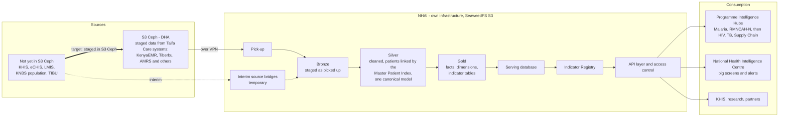

# Components and technology

The list of parts that National Health Analytics and Intelligence (NHAI) needs and the open-source tool proposed for each, to be agreed before the architecture diagram is drawn.

## Ground rules

1. **Follow the DHA Data Lake Architecture.** Every component below sits in one of DHA's boxes (sources, ingestion, bronze, silver, gold, API layer, access control, consumption, cross-cutting). NHAI adds detail and fills gaps; it does not rearrange the architecture.
2. **S3 Ceph is the source.** DHA stages data from Taifa Care systems in its S3 Ceph. NHAI reads it and has no control over it. It is the source of truth.
3. **NHAI picks the data up, stages it on its own storage, and builds everything from there.** NHAI runs on its own infrastructure with SeaweedFS as its S3 storage. Bronze, silver, gold, serving and dashboards are all NHAI's. Nothing is written back to S3 Ceph.
4. **Anything not yet in S3 Ceph comes through an interim source bridge**, built as close to the source as possible. Each bridge is marked temporary, and the advice to DHA is that these sources should be staged in S3 Ceph like the rest.
5. **Open source throughout.**
6. **Prove it on malaria and RMNCAH-N, design it to extend** to TB, HIV, supply chain and others.

## High-level flow, from S3 to dashboard

In words: NHAI picks up the data staged in S3 Ceph and lands it, unchanged, in its own bronze. It cleans the data, links patients across systems and maps everything into one canonical model in silver, shapes it for analysis in gold, loads it into a fast serving database, and defines every indicator once in the Indicator Registry. Dashboards, the Intelligence Centre and external systems all read through one API layer. Data that is not in S3 Ceph arrives through temporary bridges until DHA stages it there.

## Components and tools

The last column notes where the same tool was seen in use on the S3 Ceph side. Matching those keeps NHAI familiar to DHA's own engineers.

### Sources and ingestion

| Component | DHA box | Job | Proposed tool | Alternative | Seen at DHA? |
|---|---|---|---|---|---|
| Pick-up from S3 Ceph | Ingestion | Copy new rows from the staged tables in S3 Ceph into NHAI's bronze, recording which source snapshot each row came from | PyIceberg, run by Dagster. S3 Ceph has no table catalog, so the pick-up finds each table's newest definition file itself, as the `explorer` tool already does. | Apache Spark for the largest tables | Iceberg tables: yes |
| Interim source bridges | Ingestion | Pull KHIS, eCHIS, LMIS, population and other data not in S3 Ceph | dlt (Python library for API and database extraction) | Airbyte | No |
| Orchestration | Ingestion and all "Orchestration" arrows | Schedule and monitor every step | Dagster | Apache Airflow | Dagster: yes |

### Storage and processing

| Component | DHA box | Job | Proposed tool | Alternative | Seen at DHA? |
|---|---|---|---|---|---|
| Object storage | Bronze, silver, gold | Hold NHAI's bronze, silver and gold tables | **SeaweedFS** (decided), on NHAI's own infrastructure | none; the choice is made | DHA uses Ceph |
| Table format | Bronze, silver, gold | Database-style tables on object storage, with history | Apache Iceberg | none needed | Yes |
| Table catalog | Cross-cutting: infrastructure | One register of all NHAI tables so every tool sees the same thing | Lakekeeper, on PostgreSQL | SeaweedFS's built-in Iceberg catalog; Apache Polaris | None seen |
| Query and transformation engine | Silver, gold | Run the SQL that builds silver and gold | Trino | Apache Spark for very heavy jobs; DuckDB for development | Not seen |
| Transformation | Silver, gold | Models, tests, documentation and lineage as code | dbt Core with dbt-trino | SQLMesh | Not seen |
| Table upkeep | Cross-cutting: infrastructure | Merge small files, expire old snapshots | Trino maintenance commands, scheduled by Dagster | Spark procedures | Not done at the source |

### Silver: quality, standards and identity

| Component | DHA box | Job | Proposed tool | Alternative |
|---|---|---|---|---|
| Data quality checks | Silver: data quality checks; cross-cutting: data quality assurance | Rules on every table; thresholds and freshness per facility | dbt tests, plus Soda Core | Great Expectations, Elementary |
| Terminology service | Silver: terminology alignment | Map each system's codes to national code sets | Open Concept Lab, with the maps loaded as dbt seed tables | Snowstorm |
| Integration layer | Silver: deduplication and reconciliation | Link records across systems and keep their history (Data Vault) | dbt macros written for Trino | AutomateDV, if it supports Trino at the time |
| Master Patient Index | Cross-cutting: Master Patient Index; silver: deduplication | Recognise one person across systems and give every patient record a person key | See the Master Patient Index section below | |
| De-identification | Silver: de-identification and PII hashing | Hash identifiers; keep names and contacts in a restricted area | dbt macros, with a separate restricted Iceberg namespace | none needed |

### Gold, serving and the Indicator Registry

| Component | DHA box | Job | Proposed tool | Alternative | Seen at DHA? |
|---|---|---|---|---|---|
| Dimensional model | Gold: data marts | Facts and dimensions per programme, and indicator tables | dbt Core (Kimball style) | none needed | |
| Serving database | Gold to API | Sub-second answers for dashboards | ClickHouse | StarRocks | ClickHouse: yes |
| Indicator Registry | API: aggregate data services | Define each indicator once; serve it over an API with caching | Cube | dbt MetricFlow | No |
| Boundaries and geography | Gold | County, sub-county and ward shapes | PostgreSQL with PostGIS | GeoJSON files served from object storage | |

### API layer and access control

| Component | DHA box | Job | Proposed tool | Alternative |
|---|---|---|---|---|
| Indicator API | Aggregate data services | Indicator and summary feeds | Cube's REST and SQL APIs | Custom FastAPI service |
| Governed extracts | Query and export services | Scoped, logged line-list downloads, de-identified by default | Small FastAPI service over ClickHouse or Trino | none needed |
| API gateway | Standards-based data APIs | One entry point, rate limits, per-consumer keys | Apache APISIX | Kong (open-source edition) |
| Sign-in and roles | Authentication and tokens; role-based access control | Single sign-on; roles by programme and geography | Keycloak | Authentik |
| Data-level permissions | Role-based access control | Limit rows and columns by role | Open Policy Agent with Trino; ClickHouse row policies; Cube access rules | Apache Ranger |
| Audit trail | Audit trail | Who saw what, and when | Query logs from Trino, ClickHouse and the APIs, collected in Grafana Loki | OpenSearch |

### Consumption

| Component | DHA box | Job | Proposed tool | Alternative |
|---|---|---|---|---|
| Programme dashboards | BI and analytical insights | The designed dashboards in the RMNCAH-N mock-ups, and their malaria equivalent | A custom web application (React, Apache ECharts, MapLibre) reading the Indicator API | Evidence |
| Self-service analysis | Self-service dashboards | Programme staff build their own charts without SQL | Metabase | Lightdash |
| Advanced analysis | Self-service dashboards; research | SQL and notebooks for analysts | JupyterHub; SQL clients such as DBeaver; Apache Superset for those who want it | RStudio Server |
| Intelligence Centre displays | Alerts and notifications; BI | Wall-screen indicators and threshold alerts | Grafana (full-screen displays and alert rules) | A dedicated page in the custom web application |
| Signals and alerts | Alerts and notifications | Detect threshold breaches and unusual changes; notify | dbt and Dagster compute signals into a table; Grafana Alerting delivers them | Apprise for extra channels |
| Maps | GIS systems | Maps in dashboards; desktop analysis | MapLibre in the dashboards; Martin tile server; QGIS for analysts | Kepler.gl |
| Reports and bulletins | Reports | Scheduled bulletins and briefs as PDF or web pages | Quarto | Evidence |
| KHIS exchange | KHIS | Send agreed aggregates to KHIS | DHIS2 API, called from Dagster | Later phase |
| Natural-language questions | AI and predictive analytics | Ask questions of the indicators in plain language | A self-hosted model served with Ollama or vLLM, over the Indicator Registry | Later phase |

### Cross-cutting

| Component | DHA box | Job | Proposed tool | Alternative |
|---|---|---|---|---|
| Data catalog, glossary and lineage | Data governance | Searchable inventory, definitions, and where each figure comes from | OpenMetadata | DataHub |
| Monitoring and logging | Monitoring and logging | System health, pipeline failures, logs | Prometheus, Grafana and Loki; Dagster's own interface | none needed |
| Secrets | Security | Keep credentials out of code | OpenBao | SOPS |
| Runtime | Infrastructure | Run the services | Kubernetes for production; Docker Compose for the proof of concept | Nomad |
| Change control | Data governance | Review and test every change before release | Git, with automated dbt builds and SQLFluff checks | none needed |

## Master Patient Index

The Master Patient Index (MPI) answers one question: which patient records, in which systems, are the same person? DHA's architecture lists it as a cross-cutting capability. In NHAI it is a named component inside silver, and the Data Vault integration layer is what makes it auditable.

### What it does

1. **Collects** every patient record from every source, with its identifiers and the details needed for matching.
2. **Matches** in tiers, cheapest first, stopping at the first confident match:
   - the same national Client Registry identifier (UPI);
   - the same secondary identifier, such as a hashed national ID or birth certificate number;
   - a scored comparison of name, date of birth, sex and location, for records with no shared identifier.
3. **Records every match** as a row: the two records, the rule that matched them, the score and the date.
4. **Assigns a person key**, so one person seen in two systems carries the same key everywhere downstream.
5. **Queues uncertain matches** for a data steward to accept or reject.
6. **Reports back**: lists of records with no UPI, by facility, for remediation at source.

### Parts and tools

| Part | Job | Proposed tool |
|---|---|---|
| Identity store | Patient records, identifiers and match history, kept in a restricted area | Data Vault tables in a restricted Iceberg namespace (see the data layers paper) |
| Exact matching | Tiers one and two | dbt models on Trino |
| Scored matching | Tier three | Splink, running on DuckDB for the proof of concept and Spark at scale |
| Reference identities | The national Client Registry, as the anchor for UPIs | The Client Registry copy staged in S3 Ceph, picked up like any other table |
| Steward review | Accept or reject uncertain matches | A review queue in PostgreSQL with a simple review screen |
| Scheduling | Run after each pick-up | Dagster |

### How Data Vault helps

- **Source records are linked, never merged.** Each system's patient stays intact with its own key, so its encounters, bills and claims still resolve.
- **Every match is a row in a "same-as" link.** That gives a complete, dated ledger of who was matched to whom and why.
- **A wrong match is reversed by closing its row.** Nothing has to be untangled, and no history is rewritten.
- **The details used for matching keep their history**, so a match can be re-examined against what was known at the time.
- **A new source system is an addition.** Its patients join the same hub and are matched by the same rules.

### What limits it today

- **Scored matching is only possible for Tiberbu.** Names and addresses are staged for Tiberbu but not for KenyaEMR or AMRS, so those two can be matched on identifiers only until DHA stages their name and address tables.
- **The Client Registry copy is stale.** It was last loaded in August 2026.
- **Which identifier types each system holds is unconfirmed.** KenyaEMR and AMRS keep identifiers in a general table; how many patients carry a UPI or national ID has to be measured.

### What it means for indicators

Every indicator has to state whether it counts patient records or persons. A woman attending two facilities on different systems is two patient records and one person. Facility-level figures use the record; national figures use the person.

## SeaweedFS: what to set up and what to prove

SeaweedFS is the chosen store. It is light to run, speaks the S3 API, and Trino, Spark, DuckDB and ClickHouse can all read from it. Because it will hold national health data, these points should be built in from the start.

Set up:

- **A highly available metadata store.** SeaweedFS keeps its file index in a backing database. The default is a single embedded one; for production put it on PostgreSQL or a similar clustered store. This is the part most often under-built.
- **Replication and a second site.** Choose the volume replication setting deliberately, use erasure coding for older, rarely read data, and replicate to a second location.
- **The table catalog kept separate.** SeaweedFS now has a built-in Iceberg catalog, but it is new. Running Lakekeeper on PostgreSQL gives the catalog its own backup and restore, and losing the catalog is the one failure that loses the tables.
- **Backups that have been restored at least once.**
- **A support plan.** SeaweedFS has a small core team and no local vendor. Decide who is called when it fails.

Prove before relying on it:

1. Write about 1 TB of Iceberg data through dbt and Trino with several writers at once, then compact, expire old snapshots and read every remaining snapshot back, with no lost or stray files.
2. Stop a storage node and the index service mid-write, and confirm Trino and the catalog recover without manual repair.
3. Restore everything from backup onto fresh machines within an agreed time.
4. List a folder holding more than a million files and confirm Trino's planning time stays reasonable.
5. Run the existing indicator queries against silver and compare timings with the source systems.

## Dashboards: why three tools and not one

Superset is not favoured, and no single alternative covers all three audiences well. The proposal splits them:

- **Programme dashboards for managers and the public face of NHAI: a custom web application.** The mock-ups are designed pages with care-continuum tiles, county maps, target gaps and narrative panels. Business-intelligence tools cannot reproduce that faithfully. A custom front end over the Indicator API can, and adding a programme then means adding configuration rather than redesigning.
- **Self-service for programme staff: Metabase.** It is the easiest of the open-source tools for people who do not write SQL. One limit to plan around: in the open-source edition, permissions stop at the table level, so restricting rows by county has to be done in the database rather than in Metabase.
- **The Intelligence Centre: Grafana.** It is built for wall screens and for alerting on thresholds, and the same Grafana serves system monitoring.
- **Superset stays optional** for advanced users who want it. Nothing depends on it.

## What a Programme Intelligence Hub contains

Each programme (malaria and RMNCAH-N first) gets the same set, built from shared parts:

| Need | Provided by |
|---|---|
| Programme dashboard | The custom web application, with that programme's indicators from the Indicator Registry |
| Further analysis | Metabase, pointed at the programme's data mart in ClickHouse |
| Maps | MapLibre layers in the dashboard; QGIS for analysts |
| Line-list downloads | The governed extracts service, limited to the programme and the user's geography |
| Advanced analytics | JupyterHub, with read access to the programme's mart |

Programmes that already run their own analytics systems can instead take a feed from the API layer and keep their tools. Either way the figures come from the same gold tables.

## What the National Health Intelligence Centre gets

- **A wall-screen view** of a short list of headline indicators per programme, refreshed on a schedule.
- **Signals**: an indicator crossing its red band, a sharp change against the previous period, or a facility going silent.
- **Alerts** sent to named people when a signal fires, with a link to the detail in the relevant Programme Intelligence Hub.
- **Data freshness on display**, so the room can see how recent each figure is.

All of this reads the same Indicator API as the dashboards, so the centre and the programmes never show different numbers.

## Interim source bridges needed for the proof of concept

| Source | Needed for | Why S3 Ceph does not cover it today |
|---|---|---|
| KHIS aggregate data | Most malaria indicators; national coverage for RMNCAH-N | S3 Ceph holds 23 KHIS indicators, frozen at June 2026, none for malaria |
| KNBS population projections | Seven RMNCAH-N indicators; malaria incidence and mortality | Not staged |
| KHIS malaria case-based surveillance | Elimination (1-3-7) indicators | Not staged |
| KHIS LMIS | Commodity stock-out indicators | Not staged |
| eCHIS | Community testing | Not staged |
| County and sub-county boundaries | Maps | Not staged |

Each bridge lands raw, append-only tables in NHAI's bronze, split by source and date, the same way picked-up data does. When DHA stages a source in S3 Ceph, its bridge is switched off and the normal pick-up takes over.

## Where this adds to the DHA architecture

These are additions inside DHA's existing boxes, not changes to them.

| Addition | Where it sits | Why |
|---|---|---|
| Pick-up from S3 Ceph | Ingestion | The source is an object store of staged tables, read over a VPN, so ingestion is a scheduled copy rather than extraction from each system |
| Table catalog | Cross-cutting: infrastructure | Every tool sees the same tables without being pointed at files by hand |
| Table upkeep | Cross-cutting: infrastructure | The staged tables in S3 Ceph are made of thousands of small files; NHAI's copies are compacted as they are written |
| Canonical Health Data Model | Silver | Makes the "unified dimensional model" box concrete and independent of any one source system |
| Integration layer (Data Vault) | Silver: deduplication and reconciliation | Links patients across systems without merging them, and keeps history |
| Master Patient Index as a named component | Silver and cross-cutting | Makes identity resolution visible, auditable and reversible |
| Indicator Registry | Between gold and the API layer | One definition per indicator for every consumer |
| Programme Intelligence Hubs | Consumption | Packages DHA's consumption boxes per programme |
| Intelligence Centre view and signals | Consumption: alerts and notifications | Gives the centre a defined feed |
| Interim source bridges | Ingestion | Temporary, with a route into S3 Ceph |

## Decisions made

| Decision | Outcome |
|---|---|
| Name | National Health Analytics and Intelligence (NHAI), confirmed with DHA |
| Source | S3 Ceph, read-only and outside NHAI's control |
| Where NHAI runs | NHAI's own infrastructure. NHAI picks up, stages on its own S3, and builds everything. |
| Storage | SeaweedFS |

## Decisions still open

| Decision | Options | Leaning |
|---|---|---|
| Which ClickHouse serves the dashboards | One NHAI runs, or DHA's existing ClickHouse | NHAI's own, in line with building on its own infrastructure |
| Indicator Registry tool | Cube, or dbt MetricFlow | Cube, because it also provides the API and caching |
| Programme dashboard build | Custom web application, or a BI tool | Custom, given the mock-ups |
| Client Registry for the Master Patient Index | The copy staged in S3 Ceph (last loaded August 2026), or a live feed | Ask DHA to refresh the staged copy |
| Names and addresses for KenyaEMR and AMRS | Ask DHA to stage them, or match those systems on identifiers only | Ask DHA to stage them, into a restricted area |

Tool licences and feature limits change. Each should be re-checked when it is adopted.
