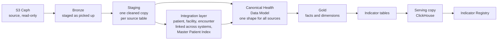
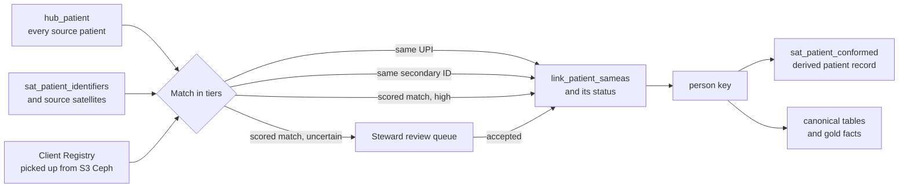

# Data layers

How NHAI organises data from pick-up to the dashboards, shown for a small set of malaria and RMNCAH-N indicators. This is a proof-of-concept design: enough to show the pattern works and how it grows, not the full model.

## The layers at a glance

| Layer | DHA box | What it holds | Style | Who reads it |
|---|---|---|---|---|
| Bronze | Bronze | Source tables exactly as picked up from S3 Ceph, on NHAI's own storage. Interim source bridges land here too. | As the source | Engineers only |
| Staging | Silver: data quality checks, standardisation | One model per source and entity. Each cleans its source (repeated rows removed, deleted rows dropped, types and time zones fixed) and outputs the same canonical columns. | One shape per entity, whatever the source | Engineers only |
| Integration layer | Silver: deduplication and reconciliation; Master Patient Index | Patients, facilities and encounters linked across systems, with history | Data Vault | Engineers only |
| Canonical Health Data Model | Silver: unified model, de-identification | One set of tables that every source system is mapped into, de-identified | Subject-area tables | Analysts, data scientists |
| Gold | Gold: data marts | Facts and dimensions, and pre-aggregated indicator tables | Kimball star schemas | Dashboards, self-service tools |
| Serving copy | Gold, towards the API layer | A copy of the gold marts and indicator tables in ClickHouse, refreshed after each gold build. Gold in Iceberg stays the master copy. | Wide tables ready for fast totals | Dashboards, through the Indicator Registry |
| Indicator Registry | API: aggregate data services | The definition of each indicator, served over an API | Metrics layer | Every consumer |

Staging, the integration layer and the canonical model are all inside DHA's silver box. They are three steps, not three extra layers in the architecture diagram.

## Bronze: staged as picked up

- **Unchanged.** Same columns and values as in S3 Ceph. No cleaning, no renaming. Cleaning belongs to staging.
- **Append-only.** Nothing in bronze is edited or deleted, so any later layer can be rebuilt from it.
- **Incremental.** Each run picks up only what S3 Ceph has added since the last run, and records on every row which source snapshot it came from and when it was picked up.
- **Only what is used.** A table is picked up when a model first needs it, not all 150 at once.
- **Compacted.** The source tables are made of thousands of small files; NHAI writes its copies as fewer, larger files so later steps run quickly.
- **Split by source system and pick-up date**, as DHA's architecture specifies for bronze.

## Staging: one adapter per source, same output shape

The model is **target-first**. The canonical tables are defined from what the indicators need, and each source system gets an adapter that maps into them. The model is not copied from the richest source and then forced onto the others.

Each staging model is named `stg_<source>__<entity>`, for example `stg_kenyaemr__patient`, `stg_amrs__patient` and `stg_tiberbu__patient`. All three output exactly the same columns, in the same types and code sets. **Everything specific to a source lives in its staging model and nowhere else.**

Staging also fixes the problems found in the source data:

| Problem found in the source data | Fix in staging |
|---|---|
| Repeated rows (KenyaEMR's encounter-type lookup holds five copies of each entry) | Keep the newest copy of each key |
| Soft-deleted rows | Drop `voided = 1` (KenyaEMR, AMRS) and `docstatus = 2` (Tiberbu) |
| Text where numbers belong (Tiberbu vitals), mixed time zones, mixed units | Cast and convert once, so silver has one type and one unit per column |
| IDs that are only unique within a facility (KenyaEMR) | Build keys from facility database plus ID |
| Clinical values stored as rows of question and answer (KenyaEMR and AMRS `obs`) where Tiberbu has columns | Pivot the rows into columns, so every source gives `temperature`, `systolic_bp` and so on |
| No record of where a row came from | Carry forward the source snapshot recorded in bronze, and add source system and source record ID |

Rules that apply to every staging model:

- **Codes are mapped with lookup tables, not written into the SQL.** A table such as `ref_sex_map` or `ref_county_map` holds source system, source value and canonical code. A value with no mapping fails a quality test; it does not quietly become empty.
- **A field a source does not have is output as empty, and that is written in the mapping spec.** Tiberbu, for example, has no "date of birth is estimated" flag.
- **Nothing is conformed that cannot be verified.** If a source uses a column inconsistently, it is output as empty with a quality flag. A visibly missing county is better than a wrong one on a dashboard.
- **Provenance travels with every row:** `source_system`, `source_record_id`, `source_updated_at` and `bronze_load_id`.

## Integration layer: Data Vault and the Master Patient Index

Data Vault is used for the core entities that exist in more than one system and have to be linked. It starts with **patient and encounter**, plus **facility** because both depend on it, and its value is measured on those before it is extended. The candidates after that are provider, diagnosis, order and claim. The patient part of it is the Master Patient Index.

### The tables

| Table | Type | Holds |
|---|---|---|
| `hub_patient` | Hub | One row per source patient (source system plus source ID) |
| `hub_facility` | Hub | One row per facility, keyed on Master Facility List code |
| `hub_provider` (later) | Hub | One row per health worker, keyed on Health Worker Registry ID |
| `hub_encounter` | Hub | One row per source visit or encounter |
| `sat_patient_kenyaemr`, `sat_patient_amrs`, `sat_patient_tiberbu` | Satellites | Each system's own patient details, with every change kept |
| `sat_patient_identifiers` | Satellite (restricted) | Each patient's identifiers: UPI, hashed national ID, birth certificate number |
| `sat_facility_registry`, `sat_facility_<source>` | Satellites | Facility details from the registry and from each source system |
| `link_patient_encounter`, `link_encounter_facility` | Links | Which patient, which facility, for each encounter |
| `link_patient_sameas` | Same-as link | "These two source patients are the same person" |
| `sat_patient_sameas_status` | Satellite on the link | For each match: the rule, the score, who or what decided it, when, and whether it is still open |
| `sat_patient_conformed` | Computed satellite | One best-known record per person, derived from all sources |
| `pit_patient`, `pit_encounter` | Point-in-time tables | For each key and date, which satellite rows were current. They keep gold builds fast and simple, and are planned from the start. |

### How the Master Patient Index uses them

1. Every patient from every source gets a row in `hub_patient`. Nothing is merged.
2. Matching runs in tiers: the same UPI, then the same secondary identifier, then a scored comparison of name, date of birth, sex and location.
3. Each match becomes a row in `link_patient_sameas`, with its rule, score and date in the status satellite.
4. Records joined by same-as links share one **person key**. A record with no match is its own person.
5. Uncertain scores go to a steward. An accepted match is written like any other.
6. `sat_patient_conformed` computes the best-known details per person, by written rules per attribute: for example, date of birth from the source where it is not estimated, county from the most recent address, deceased if any source says so. Because it is derived, changing a rule just recomputes it.

Cases to guard against: twins, common names in the same ward, and a newborn linked to a parent's record (Tiberbu's `custom_parent` must never be read as a match). A record with no UPI, no secondary identifier and a weak score stays a separate person; if a UPI is captured at a later visit it is matched then, and no history is rewritten.

### What this buys

- **Three systems, three ways of identifying a patient.** KenyaEMR uses a number unique to each facility database, AMRS a single number, Tiberbu a text code. The hub gives them one common key without changing any of them.
- **One person in two systems is linked, not merged.** Their encounters in each system still point at the right source record.
- **Every match is on record and can be undone.** A wrong match is reversed by closing its row, with nothing to untangle.
- **Repeated loads collapse to real changes.** Satellites store a row only when something changed, so the source's repeated rows disappear and what remains is a true history.
- **"What did we believe on 1 March?" has an answer.** That supports the governance committee's remediation loop: a facility can be shown exactly which of its records changed and when.
- **A fourth source system is an addition, not a redesign.** It gets its own satellites, joins the existing hubs, and is matched by the same rules.

### What it costs

- **More tables and more joins.** A conformed patient is a hub, several satellites and the same-as link.
- **A learning curve** for a team new to it. Hash keys, change detection and load dates trip up newcomers.

So it stays small, and is generated from templates, not written by hand. **High-volume events are not vaulted.** Observations, lab results and form answers are recorded once and do not change, and there are hundreds of millions of them. They go straight from staging into the canonical model, picking up the person and facility keys on the way.

In dbt the path for a vaulted entity is `stg_<source>__<entity>` → hubs, links and satellites → `int_<entity>_resolved` (identity and conflict rules applied) → `silver_<entity>`. For an event it is `stg_<source>__<entity>` → `int_<entity>_unioned` → `silver_<entity>`.

## Canonical Health Data Model

One set of tables, the same whichever system the data came from. It is organised by subject, and defined by what the indicators need. The proof of concept covers the clinical subjects below; commodities, workforce and financing are added the same way when their programmes come on.

| Canonical table | One row is | KenyaEMR | AMRS | Tiberbu |
|---|---|---|---|---|
| `silver_patient` | A person (after the Master Patient Index) | `person`, `patient_identifier` | `patient`, `person`, `patient_identifier` | `patient` |
| `silver_facility` | A health facility | `source_schema`, `location` | `location`, `facility_locations` | `company`, `company_settings` |
| `silver_encounter` | A visit or consultation | `visit`, `encounter` | `visit`, `encounter` | `patient_appointment`, `patient_encounter`, `inpatient_record` |
| `silver_diagnosis` | A diagnosis recorded at an encounter | `encounter_diagnosis`, coded `obs` | coded `obs` | `diagnosis_entry` |
| `silver_observation` | A measurement or recorded answer | `obs` | `obs` | `vital_signs`, `form_data_repository` |
| `silver_lab_test` | A test ordered, with its result | `orders`, `obs` | `orders`, `obs` | `lab_prescription`, `lab_test`, `normal_test_result` |
| `silver_prescription` | A medicine prescribed | `drug_order`, `orders` | `drug_order`, `orders` | `doctor_drug_prescription` |
| `silver_dispensing` | A medicine handed over | `medication_dispense` | `pharmacy_drug_extra` | `drug_prescription` |
| `silver_immunisation` | A vaccine dose given | Immunizations encounters | (very little) | Vaccine forms |
| `silver_programme_enrolment` | Enrolment in a programme (ANC, CWC, family planning) | Enrolment encounter types | (very little) | `health_program_enrollment` |
| `silver_maternal_contact` | An antenatal or postnatal contact | MCH Mother Consultation | (very little) | Present Pregnancy, Postnatal Care forms |
| `silver_delivery` | A birth and its outcome | MCH Partograph, MCH Inpatient | (very little) | ChildBirth, Summary of Labour forms |
| `silver_death` | A death, with cause and audit status | `person`, Mortality encounters | `person` | `death_notification` |

Every canonical table carries the same housekeeping columns: `person_key`, `facility_key`, `source_system`, `source_record_id`, `source_updated_at` and `bronze_load_id`. The patient table also carries `match_rule` and `match_score` from the Master Patient Index.

**The model is versioned like an API.** Adding a column is free. Renaming a column or changing what it means breaks gold, so it is done as a new version with both running for a short time. Names, phone numbers and national IDs are not in this model; they stay in the restricted area used by the Master Patient Index.

The source tables named here were all found in S3 Ceph during the exploration (see `docs/exploration/`). Which form fields and concepts inside them carry each value still has to be confirmed.

## Gold: dimensions and facts

### Dimensions, shared by every programme

| Dimension | One row is | Notes |
|---|---|---|
| `dim_date` | A day | With month, quarter, financial year and epidemiological week |
| `dim_facility` | A facility | Master Facility List code, level, ownership, county, sub-county, ward. Keeps history when a facility changes level or ownership. |
| `dim_geography` | A county, sub-county or ward | With malaria attributes: epidemiological zone, elimination county, seasonal chemoprevention area, vaccine area |
| `dim_patient` | A person, de-identified | Sex, date of birth, home county where known |
| `dim_age_group` | An age band | The bands the indicators report on (under 5, 10 to 14, 15 to 19, and so on) |
| `dim_diagnosis` | A diagnosis code | With its national reporting group, such as malaria or pneumonia |
| `dim_lab_test` | A type of test | With a malaria flag and test method (rapid test, microscopy) |
| `dim_medicine` | A medicine | With class, such as ACT or amoxicillin dispersible tablet |
| `dim_vaccine` | A vaccine and dose number | |
| `dim_programme` | A programme | Malaria, RMNCAH-N, later HIV, TB and others |
| `dim_indicator` | An indicator | Name, level, polarity, targets and colour bands, loaded from the core indicator framework |
| `dim_source_system` | A source | KenyaEMR, AMRS, Tiberbu, KHIS |

### Facts

| Fact | One row is | Used by |
|---|---|---|
| `fact_encounter` | A visit to a facility | Both: outpatient attendance, denominators |
| `fact_diagnosis` | A diagnosis recorded | Both |
| `fact_lab_test` | A test result | Malaria: testing and positivity |
| `fact_medication` | A medicine prescribed or dispensed | Malaria: ACT treatment. RMNCAH-N: pneumonia and diarrhoea treatment |
| `fact_admission` | An inpatient stay and its outcome | Malaria: inpatient deaths |
| `fact_malaria_case` | A confirmed malaria episode, with flags for tested, treated with ACT, admitted, died | Malaria: built from the four facts above so each indicator is a simple count |
| `fact_anc_contact` | An antenatal contact, numbered within the pregnancy | RMNCAH-N: ANC coverage. Malaria: preventive treatment in pregnancy, nets issued |
| `fact_delivery` | A birth | RMNCAH-N: skilled delivery, stillbirths, live births |
| `fact_pnc_contact` | A postnatal check for mother or baby | RMNCAH-N |
| `fact_immunisation` | A vaccine dose given | RMNCAH-N: immunisation. Malaria: vaccine doses |
| `fact_death` | A death, with maternal and newborn detail and audit status | RMNCAH-N: maternal and neonatal mortality, audits |
| `fact_khis_value` | A KHIS figure for one indicator, facility and month | Both: national coverage |
| `fact_population` | A projected population for an area, year, age and sex | Both: denominators |
| `fact_indicator_value` | An indicator's numerator, denominator and value for one period, place and group | Everything downstream. This is DHA's "pre-aggregated indicator cube". |

### Which facts use which dimensions

| Fact | Date | Facility | Geography | Patient | Age group | Diagnosis | Lab test | Medicine | Vaccine | Indicator | Source |
|---|:-:|:-:|:-:|:-:|:-:|:-:|:-:|:-:|:-:|:-:|:-:|
| `fact_encounter` | ● | ● | ● | ● | ● | | | | | | ● |
| `fact_diagnosis` | ● | ● | ● | ● | ● | ● | | | | | ● |
| `fact_lab_test` | ● | ● | ● | ● | ● | | ● | | | | ● |
| `fact_medication` | ● | ● | ● | ● | ● | | | ● | | | ● |
| `fact_admission` | ● | ● | ● | ● | ● | ● | | | | | ● |
| `fact_malaria_case` | ● | ● | ● | ● | ● | ● | ● | ● | | | ● |
| `fact_anc_contact` | ● | ● | ● | ● | ● | | | | | | ● |
| `fact_delivery` | ● | ● | ● | ● | ● | | | | | | ● |
| `fact_pnc_contact` | ● | ● | ● | ● | ● | | | | | | ● |
| `fact_immunisation` | ● | ● | ● | ● | ● | | | | ● | | ● |
| `fact_death` | ● | ● | ● | ● | ● | ● | | | | | ● |
| `fact_khis_value` | ● | ● | ● | | | | | | | ● | ● |
| `fact_population` | ● | | ● | | ● | | | | | | ● |
| `fact_indicator_value` | ● | ● | ● | | ● | | | | | ● | ● |

This table is how the model grows. A new programme adds rows (its own facts) and reuses the columns (the shared dimensions). HIV would add `fact_art_visit` and `fact_viral_load`; TB would add `fact_tb_case` and `fact_tb_outcome`; supply chain would add `fact_stock_status`. None of them needs a new date, facility, geography or patient dimension.

## Proof-of-concept indicators

Six per programme, chosen to exercise every part of the model. "Today" says where the data would come from now.

| Indicator | Numerator from | Denominator from | Today |
|---|---|---|---|
| MAL-07 Malaria test positivity rate | `fact_lab_test`: positive malaria tests | `fact_lab_test`: all malaria tests | S3 Ceph (three EMRs) |
| MAL-10 Suspected malaria cases tested | `fact_malaria_case`: suspected cases with a test | `fact_malaria_case`: suspected cases | S3 Ceph |
| MAL-13 Confirmed cases treated with ACT | `fact_malaria_case`: confirmed and given ACT | `fact_malaria_case`: confirmed | S3 Ceph; prescriptions in KenyaEMR and AMRS are affected by a gap in their orders tables |
| MAL-04 Inpatient malaria case fatality | `fact_admission`: malaria admissions ending in death | `fact_admission`: malaria admissions | S3 Ceph |
| MAL-08 Preventive treatment in pregnancy, 3+ doses | `fact_anc_contact`: women with a third dose | `fact_anc_contact`: first ANC contacts in targeted counties | S3 Ceph (Tiberbu forms); KHIS bridge for national coverage |
| MAL-01 Confirmed malaria incidence | `fact_khis_value` or `fact_malaria_case` | `fact_population` | Needs the KHIS and population bridges |
| RMN-03 Eight or more ANC contacts | `fact_anc_contact`: women reaching contact 8 | `fact_population`: expected pregnancies | KHIS figure staged in S3 Ceph; population bridge for the denominator |
| RMN-02 Skilled delivery rate | `fact_delivery`: facility births with a skilled attendant | `fact_population`: expected deliveries | KHIS figure staged in S3 Ceph; population bridge |
| RMN-01 Facility maternal mortality ratio | `fact_death`: maternal deaths in facilities | `fact_delivery`: facility deliveries | KHIS figures staged in S3 Ceph |
| RMN-06 Facility neonatal mortality rate | `fact_death`: deaths in the first 28 days | `fact_delivery`: live births | KHIS figures staged in S3 Ceph |
| RMN-11 Fully immunised child | `fact_immunisation`: children with all doses by 12 months | `fact_population`: surviving infants | S3 Ceph (Tiberbu and KenyaEMR vaccine records); population bridge |
| RMN-16 ANC clients aged 10 to 19 | `fact_anc_contact`: first contacts by girls aged 10 to 19 | `fact_anc_contact`: all first contacts | S3 Ceph, fully computable |

Where an indicator can come from both KHIS and patient records, `fact_indicator_value` stores both, labelled by source. The dashboard shows the agreed one and the other is kept for reconciliation.

Each indicator also states whether it counts patient records or persons, using the person key from the Master Patient Index.

## Indicator Registry

Each indicator is defined once, with everything a dashboard needs:

| Field | Example (MAL-07) |
|---|---|
| Code and name | MAL-07, Malaria Test Positivity Rate |
| Numerator | Count of `fact_lab_test` rows where the test is a malaria test and the result is positive |
| Denominator | Count of `fact_lab_test` rows where the test is a malaria test |
| Format | Percentage |
| Polarity | Lower is better |
| Target and colour bands | Per epidemiological zone; amber within 5 points above target, red beyond |
| Allowed breakdowns | County, zone, age group, test type, month |
| Frequency | Monthly |
| Counts | Tests (not persons) |
| Owner | National Malaria Programme |
| Source documents | Core Indicator Framework (30 October 2026); Kenya Malaria Strategy, Annex 4 |

The descriptive fields load from the Multi-Programme Core Indicator Framework spreadsheet into `dim_indicator`. The calculation lives in the Indicator Registry. Programme dashboards, Metabase, the Intelligence Centre displays and any external feed all request "MAL-07 by county for October" and get the same answer.

## Privacy across the layers

| Area | Contains | Who can read |
|---|---|---|
| Bronze, staging | Names, phone numbers, national IDs, clinical notes | Pipeline accounts only |
| Restricted identity area | Identifiers and details needed to match people | The Master Patient Index job and data stewards only |
| Canonical model | Patient-level, de-identified: a person key, no names or contacts | Named analysts, by programme |
| Gold facts | Patient-level, de-identified | Programme Intelligence Hubs, through governed extracts |
| Research extracts | Patient-level, with the person key replaced by a new one for each project, so releases cannot be joined to each other | Approved researchers |
| Indicator tables | Counts only | All dashboards and the Intelligence Centre |
