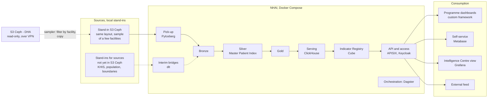

# Local end-to-end proof of concept: plan and roadmap

Written 13 November 2026. This is the plan for building every box on the NHAI high-level architecture ([diagram](../planning/diagrams/nhai-high-level.png)) on one laptop, from a stand-in for S3 Ceph through to a dashboard. The stand-in holds a sample of real rows from a few facilities, personal identifiers included.

It follows the planning papers in [`planning/`](../planning/README.md) and does not change them. Where a paper already settles something (naming, dbt layout, the malaria indicators), this plan points to it. One thing differs: the six RMNCAH-N indicators are now the ones in DHA's demonstration mock-up, not the six in the data layers paper (see [The slice](#the-slice)).

## Aim

Run the whole flow locally with one command:

**stand-in S3 Ceph → pick-up → bronze → silver → gold → ClickHouse → Indicator Registry → API → custom dashboard**

The VPN is needed only while the sample is being taken. After that everything runs offline.

| The proof of concept proves | It does not prove |
|---|---|
| Every box on the diagram connects to the next, with the chosen tools | Speed or behaviour at real volume (the five SeaweedFS tests need real hardware) |
| Pick-up works on a source with no table catalog, and picks up only what is new | That the mappings hold for every facility; they are proved for the sampled ones |
| The mappings work on real rows: which codes, test names and form fields carry each indicator | How accurate scored patient matching is beyond the nine facilities, or for KenyaEMR and AMRS, whose names are not in S3 Ceph |
| dbt on Trino builds silver and gold on Iceberg, Lakekeeper and SeaweedFS | High availability, backup and restore |
| The Master Patient Index links one person across systems, first by shared identifier and then by scored matching with Splink, and a match can be undone | Production security |
| One indicator definition feeds the dashboard, self-service and the Intelligence Centre view | |
| A programme dashboard is added by configuration, without Superset | |
| Identifiers and names are in clear only in a restricted area; silver holds them hashed, by configuration; gold and the dashboards hold none | |

## Where it stands

As of 16 November 2026.

| Stage | State |
|---|---|
| 1. Facilities and column rules | Done. The Master Facility List holds seven facilities with their FID and MFL codes. Two of them are on two systems, which gives the nine facility entries the sampler copies |
| 2. Stand-in S3 Ceph | Done for twelve tables across Tiberbu, KenyaEMR and AMRS: the ten RMN-16 needs and the two that name identifier types. It can be exported to one encrypted file and imported on another laptop |
| 8. Widen source and silver | The sourcing half is done for the six RMNCAH-N indicators (16 November 2026): Tiberbu forms and death notifications, a wider Tiberbu patient table, KenyaEMR and AMRS visit answers for maternal and child visit types, concept names, and the KHIS files. The stand-in now holds 21 tables, 11,942,618 rows, 306 MB. Not yet sampled: lab, admissions, client registry. Silver is not started |
| 0, 3 to 7, and 9 onwards | Not started. Stage 0 exists only as far as stages 1 and 2 needed it: one service in `compose.yaml`, the `Makefile`, and local settings |

Checks run on the first sample:

| Check | Result |
|---|---|
| The stand-in holds exactly the rows kept, for all six tables | Pass |
| Columns marked empty are empty | Pass |
| Counts per facility and month equal the same counts on the real S3 Ceph, reading every source file | Pass for the four facility-selected tables (1,297 facility-months) |
| The explorer, unchanged, lists and queries the stand-in with the read-only key | Pass |
| `make purge` covers the stand-in | Pass on a dry run; the real run was tested on a throwaway copy |
| Every sampled enrolment's patient is in the sample | 3,567 of 7,391. The rest are not in S3 Ceph; see the first finding |

### Findings from the first sample

1. **S3 Ceph's Tiberbu patient table holds only patients created or changed since late July 2026.** At the three sampled facilities, 3,824 of the 7,391 patients that programme enrolments refer to have no patient record in S3 Ceph. Every enrolment from August 2026 onward has its patient; before that, about half do not. For ANC, 1,170 of 2,235 clients are affected. So RMN-16, which needs each client's date of birth, can be computed in full only from August 2026. DHA should be asked to load the patient table in full. **Decided 16 November 2026: work with data from August 2026.** Tiberbu indicators that need the patient record report from August 2026 only. In the sample that is 464 ANC clients from August to mid-November, 99% with a date of birth, against 18 to 53% in earlier months. The start month is kept in a managed list of how far back each source table is complete, not written into the models, so it moves when DHA backfills. Two limits follow: no 12-month or year-on-year view for Tiberbu yet, and no month in common with the KHIS figures in S3 Ceph, which end in June 2026.
2. **A Tiberbu record key is unique only within a county.** 638 of the missing patient keys also exist under other counties, where they belong to different people. Every Tiberbu join must include `county_id`, the same way every KenyaEMR join must include `source_schema`.
3. **The three systems do not share one county.** AMRS maternity care is almost all in Uasin Gishu. KenyaEMR's busiest maternity databases are in counties where Tiberbu is not deployed. Tiberbu covers 42 counties. The proposed sample is therefore Uasin Gishu and Kakamega for AMRS and Tiberbu, plus three KenyaEMR databases elsewhere. Turbo and Moi's Bridge are on both AMRS and Tiberbu, which is where people appearing in two systems will come from.
4. **Skipping source files works for Tiberbu and not for KenyaEMR.** See "Getting it across the VPN".
5. **Tiberbu names its malaria tests thirteen ways.** "Malaria BS" and "Malaria Rapid Diagnostic Test" make up most of 510,000 tests in twelve months. The list is in `explorer/out/facility_selection_tiberbu_malaria_tests.csv` and becomes the first code map in stage 8.

## The local picture

Same boxes and same arrows as the diagram. Only the source is a stand-in, and everything runs in Docker Compose.



Transformation (dbt, Trino) and tables and storage (Iceberg, Lakekeeper, SeaweedFS) sit under bronze, silver and gold exactly as drawn. The sampler is a tool for building the stand-in. It is not an NHAI component and does not appear on the architecture.

## Every box on the diagram, and what stands in for it locally

| Box on the diagram | Locally | Built in |
|---|---|---|
| **S3 Ceph** (KenyaEMR, AMRS, Tiberbu) | A separate S3 container holding bucket `dha-analytics` with the real folder layout and no table catalog, filled with a sample from a few facilities, personal identifiers included. Pick-up gets a read-only key. | Stages 1 and 2 |
| **KHIS and other sources not in S3 Ceph** | Files in each source's own export shape, limited to the sampled counties: KHIS aggregate values, KNBS population, county boundaries | Stage 9 |
| **Pick-up** | Python with PyIceberg, reusing the explorer's way of finding each table's newest definition file | Stage 3 |
| **Interim bridges** | dlt pipelines reading those files, landing in bronze, each marked temporary | Stage 9 |
| **Bronze, silver, gold** | Iceberg namespaces in one warehouse | Stages 3 to 5, widened in 8 to 12 |
| **Master Patient Index** | In two steps: dbt models matching on shared identifiers, then Splink on DuckDB for scored matching. Both write to the same-as link. | Stages 11 and 12 |
| **Master Facility List** | Two files the team manages, `master_facility_list.csv` and `facility_source_keys.csv` under `transform/seeds/`, loaded as dbt seeds | Stage 1, used from stage 2 |
| **Transformation** | dbt Core with dbt-trino; one Trino node with capped memory | Stage 4 |
| **Tables and storage** | SeaweedFS (NHAI's own, a different container from the stand-in source), Lakekeeper on PostgreSQL | Stage 3 |
| **Serving** | ClickHouse, single node, the POC's own | Stage 5 |
| **Indicator Registry** | Cube, reading ClickHouse | Stage 6 |
| **API and access** | APISIX as the gateway, Keycloak for sign-in and roles | Stage 13 |
| **Orchestration** | Dagster: one code location running pick-up, bridges, dbt, the ClickHouse load and matching | Stage 3 onwards |
| **Programme Intelligence Hubs: dashboards** | The custom dashboard framework (below) | Stage 7, widened in 10 |
| **Programme Intelligence Hubs: self-service** | Metabase on the programme marts in ClickHouse | Stage 14 |
| **National Health Intelligence Centre** | Grafana wall-screen view and alert rules, reading the Indicator Registry | Stage 14 |
| **External systems** | A keyed API consumer through the gateway, and a stub that receives a KHIS-style push | Stage 14 |
| **Catalog and lineage** | dbt docs from the first build; OpenMetadata last, run on demand | Stages 4 and 15 |
| **Data quality** | dbt tests after every build, surfaced as Dagster checks | Stage 4 onwards |
| **Monitoring** | Prometheus and Grafana | Stage 15 |
| **Change control** | Git, with SQLFluff and a dbt build run before each commit | Stage 0 |
| **Runtime** | Docker Compose with profiles. Kubernetes is for production and is not part of this. | Stage 0 |

## The stand-in S3 Ceph: a sample from a few facilities

This is the first job. The stand-in has to look like S3 Ceph to the pick-up, hold real rows so the mappings are tested for real, and carry the personal identifiers the Master Patient Index is built on.

### Before the first sampling run

**Approvals are in place** (confirmed 16 November 2026) for identifiable patient-level rows to be held on this laptop. The sample carries names, contacts and identifiers in clear. If an approval is withdrawn, `make purge` clears the laptop, and the same sampler can write to a stand-in on a machine inside the permitted environment.

**Encrypt the disk.** See [Handling the sample](#handling-the-sample).

### Choosing the facilities

Nine facility entries, three per system, in one or two neighbouring counties. They are seven facilities: Turbo and Moi's Bridge are on both Tiberbu and AMRS. They are chosen with the explorer, using totals only.

| Criterion | Why |
|---|---|
| All three systems have facilities in the same area. AMRS has the narrowest footprint (202 facilities), so start from where AMRS is. | Some people will have records in more than one system, which the Master Patient Index needs |
| Malaria-endemic, with real malaria testing volumes | The malaria indicators need cases |
| Active ANC, delivery and postnatal care records | RMN-16, RMN-04 and RMN-08 need them |
| At least one hospital on Tiberbu and one on KenyaEMR with maternal or neonatal deaths notified, or reported to KHIS | RMN-01, RMN-06 and RMN-05 count deaths, and small facilities have none |
| Reports to KHIS for July 2025 to June 2026 | The indicators can be reconciled against KHIS |
| At least 12 months of history and still loading | Trends, and a real incremental pick-up |
| A mix: one hospital, one health centre and one smaller facility per system | Different record patterns |
| Total sample under about 3 GB | Fits the laptop. An average facility is tens of megabytes, so nine busy ones fit. |

The chosen facilities are entered in the [Master Facility List](#the-master-facility-list), and their source keys are marked `in_sample`. The sampler reads both files to know what to copy.

### How rows are selected

No current source table is split by facility, and each system names its facility differently.

| Source | Filter | Tables without a facility column |
|---|---|---|
| KenyaEMR | `source_schema`, present on all 53 tables. Visit answers (`obs`) are further limited to the sampled visits of the listed visit types. | None |
| Tiberbu | `company`, present on 23 tables. `county_id`, present on nearly all, is a coarse first filter. | 34 tables, including `patient`, `diagnosis_entry`, `normal_test_result`, `lab_prescription`, `doctor_drug_prescription`. Child rows are taken where `parent` is a sampled encounter or lab test; patients are those any sampled row refers to. |
| AMRS | `location_id`, present on 8 tables including `visit`, `encounter` and `obs` | 33 tables. `patient`, `person`, `orders` and `drug_order` are taken through the patient, encounter and order keys of the sampled rows. Visit answers (`obs`) are taken through the sampled encounters of the listed visit types. |
| Client registry | Only rows whose identifier matches a sampled patient (31.8 million rows in the source) | |
| KHIS, lookup tables | Whole. They are small and hold no patient data. The KHIS figures are plain files and are copied as files. | |
| Facility registry | Not sampled. Facility details come from the Master Facility List. | |

- **Rows are copied as they are.** Repeated rows, soft-deleted rows, vitals stored as text and packed JSON forms all come across. The faults the pipeline must handle are the real ones.
- **Full history for the chosen facilities.** No date cut. August 2026 is where reporting starts, not where sourcing starts (confirmed 16 November 2026).
- **Visit answers are limited by visit type** (decided 16 November 2026). KenyaEMR and AMRS keep every answer in one `obs` table, mostly from HIV care: about 50 million rows for the three KenyaEMR facilities alone. Only the answers recorded at maternal and child visit types are copied. The types are listed in `source-sample/visit-types.csv`; adding one means another read of the table.
- **A patient's records at facilities outside the sample are not copied.** Their history stops at the sample's edge.
- **Only the tables the current stage needs** (about 30 of the 227 in the end).

### Keeping the shape of S3 Ceph

- **Same address shape.** Bucket `dha-analytics`, the same paths (`iceberg/hmis_kenya_emr_conso/<table>/`, `iceberg/hmis_ampath_prod/`, `iceberg/hmis_tiberbu_ingestion/`, `iceberg/facility_safaricom/`, `iceberg/hie_tiberbu_iceberg/`, `khis/khis_apis_v2/`), path-style addressing.
- **No table catalog.** Each table is a folder with `data/` and `metadata/`, and definition files named `NNNNN-<uuid>.metadata.json`, as in the real bucket.
- **Same columns and types** as the source table, including the columns whose values are emptied.
- **Loaded in three appends.** Each table is written as three loads, split on each row's own change date at 1 July and 1 October 2026, so "pick up only what is new" is tested. This is an approximation of the source's load history, which has thousands of small loads. For now the sampler replaces a table each time it runs; appending only what S3 Ceph has added since is still to build.
- **Read-only to NHAI.** Pick-up holds a key that can only list and read.
- **Swappable by configuration.** Pick-up reads `SRC_S3_*` settings. Locally they point at the stand-in; pointing them at the real S3 Ceph needs no code change. Only the sampler uses the real credentials.

### Personal data: kept for the Master Patient Index, held apart

Decided 16 November 2026: the sample keeps personal identifiers and names in clear, because the Master Patient Index is built on them. The POC therefore treats personal data the way the shared environment will. It arrives as it is in the source, and silver hashes it.

Every text column in a sampled table gets one rule in `source-sample/column-rules.csv`, one line per column, in git. The tables the sampler copies are listed in `source-sample/sample-tables.csv`, each with how its rows are chosen (by facility, by the patients a sampled table refers to, by the sampled encounters of the listed visit types, whole, or as plain files). `make check-rules` fails if a text column in any listed table has no rule, if a rule names an unknown treatment, or if a credential column is not emptied.

| Kind of column | Examples | Rule |
|---|---|---|
| Identifiers | National ID, UPI, phone numbers, insurance numbers, `patient_identifier.identifier` | Identity: copied in clear |
| Names | Tiberbu `first_name`, `middle_name`, `last_name`, `patient_name`, consent party | Identity: copied in clear |
| Address detail | Village, landmark, street | Identity: copied in clear. County, sub-county and ward are ordinary columns. |
| Credentials | `company_settings`: `secret`, `password`, `private_key`, `consumer_key` | Emptied in the sampler. The columns stay, so pick-up's rule to leave them behind is still tested. |
| Free text | `doctors_notes`, `obs.value_text`, `comments`, free-text form answers | Emptied in the sampler, unless the column is listed as needed by an indicator. Matching does not use it. |
| Packed form answers | Tiberbu `form_data_repository` | Only the listed fields are kept inside the JSON |
| Record keys, dates, sex, date of birth, codes, numbers, facility names | `patient_id`, `encounter_id`, Tiberbu `name` | Kept. Joins, ages and tracing a row back to the source depend on them. |

Where the identity columns are allowed to be:

| Layer | What it holds | Who reads it |
|---|---|---|
| Stand-in S3 Ceph and bronze | Identity columns in clear, as in the source | The pipeline only |
| `silver_restricted` | The identity store: patient hub, identifier and name satellites, same-as link | The matching job only |
| Silver | A person key, with each personal field hashed, dropped or kept as the configuration says | Named analysts |
| Gold, ClickHouse, the Indicator Registry, every dashboard | A person key. No personal fields, hashed or clear. | Programme users |

- **Every text column needs a rule.** If a table has a text column with no line in `column-rules.csv`, the sampler stops. Numbers, dates and flags pass through unless listed.
- **A scan runs after every build.** It looks for clear names, phone numbers and IDs in silver, gold and ClickHouse, and fails the run if it finds any.
- **Access is set in the catalog and in Trino.** An analyst login cannot read the stand-in, bronze or `silver_restricted`.
- **This list is the start of the "how personal data is treated" column** of the source-to-target mapping spec.
- **What S3 Ceph actually holds.** Names, contacts and addresses are staged for Tiberbu and the Client Registry only. KenyaEMR and AMRS have identifiers and no name tables, so they are matched on identifiers until DHA stages their names.

### Hashing in silver, by configuration

Decided 16 November 2026. No model names a hash function. One block in `transform/dbt_project.yml` lists every personal field in the canonical model and what silver does with it:

```yaml
vars:
  personal_data:
    national_id:   {treatment: hash, tidy: id}
    upi:           {treatment: hash, tidy: id}
    phone_number:  {treatment: hash, tidy: phone}
    first_name:    {treatment: hash, tidy: name}
    last_name:     {treatment: hash, tidy: name}
    village:       {treatment: drop}
    date_of_birth: {treatment: keep}
```

- **How it is applied.** Each staging adapter renames its source columns to the canonical field names, then passes its final select through one macro, `protect()`. The macro looks up each column in the list and hashes, drops or keeps it.
- **To add or remove a field, change one line and rebuild silver.** The clear values are still in `silver_restricted`, so nothing is lost and the change can be reversed.
- **Three treatments:** `hash`, `drop` and `keep`. A hashed field keeps its name with `_hash` on the end.
- **Values are tidied before hashing**, so the same ID or phone number gives the same hash whichever system it came from. Empty and junk values stay empty.
- **The hash is keyed** (HMAC-SHA-256), with the key read from the environment and never in git. Without a key, phone numbers and IDs could be recovered by trying every possible value.
- **Hashes stop at silver.** Gold and everything after it carry the person key only.
- **A field left off the list is caught by the scan**, and staging adapters select columns by name, so a source column reaches silver only if someone mapped it.

| Treatment | Fields to start with |
|---|---|
| `hash` | National ID, UPI, birth certificate number, passport number, insurance number, phone number, email, name parts |
| `drop` | Village, landmark, street, next-of-kin details |
| `keep` | Date of birth, sex, county, sub-county, ward |

### Handling the sample

- **The disk must be encrypted before the first sampling run.** On 16 November 2026 Windows reported BitLocker as off on C:, which is where the Docker volumes live.
- **It lives only in Docker volumes**, and never in git.
- **`make purge` clears all data on demand.** See below.
- **It reaches teammates as an encrypted export, not over the VPN.** `make export-source` writes one file protected by a passphrase and `make import-source` loads it and checks the row counts. The file goes only to people cleared to hold the data, over an approved channel, with the passphrase sent separately.
- **No row-level output goes into documents, chats or screenshots.** Totals only, as with the explorer. This covers AI assistants too: any query they run on identity columns returns counts, never rows.

### Clearing all data on demand

One command, `make purge`, removes every copy of the data from this laptop. It exists before the first row is sampled.

| It removes | Why |
|---|---|
| The stand-in S3 Ceph volume | The sample itself |
| The NHAI SeaweedFS volume | Bronze, `silver_restricted`, silver and gold |
| The PostgreSQL volume | The table catalog, Dagster's run history, Keycloak and Metabase settings |
| The ClickHouse volume | The serving copy |
| Trino spill space and Dagster's local storage, under `.data/` | Rows can sit in working files |
| The explorer's `out/` and `.cache/` folders | Query results can hold personal data |
| Exports of the stand-in, under `exports/` | Each one is a full copy of the sample, encrypted |
| The matching folder's DuckDB files and outputs | Splink reads clear names |
| dbt's `target/` and `logs/` folders | Compiled SQL carries the hash key |
| The hash key, `.secrets/hash_key` | With the data gone the key has no use; the next sample gets a new one |

- **It asks before it deletes.** The word `purge` has to be typed, or `CONFIRM=purge` passed for a scripted run.
- **It works with the services stopped**, so it does not depend on anything starting cleanly.
- **It touches only this project.** Volumes are removed by the POC's own Compose project name, so the other stacks on this machine are left alone.
- **It checks its own work.** It ends by listing each volume and folder above and fails if any still exists or holds a file.
- **It leaves a record.** One line with the date and what was removed is added to `poc/purge.log`, which holds no data and can be shown to DHA.
- **It keeps the code and the configuration:** the Master Facility List, `column-rules.csv`, the manifests (totals only) and everything in git.
- **Smaller resets stay.** `make reset-source` deletes only the stand-in, and `make reset` deletes what was built from it.
- **Deleting is enough only on an encrypted disk.** On an unencrypted disk, deleted files can be recovered.

### Getting it across the VPN

- **Measured on 16 November 2026.** The sampler skips any source file whose recorded lowest and highest value rule out the sampled facilities. For Tiberbu this works well: 6 to 9% of a table is read, because each file holds one county. For KenyaEMR it barely helps: 62 to 94% is read, because each file mixes many facilities. The six first tables need about 2 GB read over the VPN. `make measure` repeats the measurement without copying anything.
- **Retries, and a rerun continues.** Source files are read in groups, and each finished group is recorded. A dropped connection costs one group. A run that stops part-way continues from the last finished group when it is run again, on the same source snapshot. Until a table is finished, its part-read rows sit in `.data/sampler`, which `make purge` removes.
- **A table chosen through another reads that table's keys from the stand-in**, so tables already sampled are not read again over the VPN.
- **A manifest is written** for every table: the source snapshot it was taken from, rows read, and rows kept per facility.

### How the result is checked

There are no planted answers with real data. Four checks replace them.

1. **The sample equals the source.** Row counts per table, facility and month in the stand-in match the same counts run by the explorer on the real S3 Ceph.
2. **Each indicator matches an independent count.** A plain SQL count, written separately from the dbt models and run on the stand-in's source tables, gives the same figure as the dashboard.
3. **Each indicator is reconciled with KHIS** for the same facilities and months, with the differences explained in writing.
4. **The tricky logic has unit tests** on a few hand-made rows with exact answers: age bands, contact numbering, repeated rows, identifier match rules.
5. **Where a table is chosen through another table's patients, the sampler reports how many of those patients the source holds.** A shortfall is a gap in the source, recorded in the table's manifest, and is not hidden.

**Proof the stand-in works:** the existing `lake-explorer`, unchanged, lists and queries it when its settings point there.

## The Master Facility List

Decided 16 November 2026. NHAI keeps its own Master Facility List as the single source of truth for facilities and their identifiers, beside the Master Patient Index for people. DHA identifies a facility by its FID. KHIS identifies it by its MFL code. The list holds both, so records that arrive under either can be joined.

For the POC it is two files, managed by the team. Each facility appears once in the first. The mapping between FID and MFL code is kept there by the team.

[`transform/seeds/master_facility_list.csv`](transform/seeds/master_facility_list.csv), one row per facility:

| Column | What goes in it |
|---|---|
| `fid` | DHA's facility identifier |
| `mfl_code` | The code KHIS reports against |
| `facility_name` | The name shown on dashboards |
| `county`, `sub_county` | Where the facility is |
| `keph_level` | Level of care, 1 to 6 |
| `ownership` | Who runs it, as DHA's facility registry records it |

[`transform/seeds/facility_source_keys.csv`](transform/seeds/facility_source_keys.csv), one row per name a source system uses for a facility:

| Column | What goes in it |
|---|---|
| `fid` | The facility |
| `source_system` | `tiberbu`, `kenyaemr` or `amrs` |
| `source_facility_key` | How that system names the facility: `company`, `source_schema` or `location_id` |
| `in_sample` | `true` if the sampler should copy this facility's records from this system |

- **To add a facility, add one row to the first file and one to the second for each system it reports through.** No code changes.
- **A facility on two systems, or with several AMRS locations, has several source keys and still one row in the list.** Kesses Health Centre is three AMRS locations; Turbo and Moi's Bridge are on both Tiberbu and AMRS.
- **Three things read it.** The sampler copies the facilities marked `in_sample`. The staging adapters turn each source's own facility key into a FID. `dim_facility` takes its name, county, level and ownership from it.
- **KHIS figures join on `mfl_code`, patient records on `fid`**, and both land on the same facility.
- **A record from a facility that is not on the list fails a test.** It is never dropped silently and never guessed.
- **The rules are checked on every build:** FID and MFL code filled in and not repeated, name and county filled in, level between 1 and 6, every source key pointing at a listed facility, and a known source system. They sit beside the files in `master_facility_list.yml`.
- **In the shared environment** the list grows from nine facilities to all of them and is kept by a data steward. Whether it is then fed from DHA's facility registry is a decision for that stage.

## The slice

Working rule 1 of the [approach paper](../planning/04-approach-and-roadmap.md) applies: one thin thread through every box first, then widen. There are twelve indicators, six per programme, taken in an order where each one adds something new. The malaria six are those in the [data layers paper](../planning/03-data-layers.md). The RMNCAH-N six are those in DHA's [demonstration mock-up](../resources/RMNCAH-N_DHA_National_Intelligence_Demo.html).

| Order | Indicator | What it adds |
|---|---|---|
| 1 (the thread) | RMN-16 ANC clients aged 10 to 19 | Patient and programme enrolment from Tiberbu and KenyaEMR; fully computable from S3 Ceph |
| 2 | MAL-07 Malaria test positivity | Lab results in three shapes: rows of question and answer (KenyaEMR, AMRS) against result tables (Tiberbu) |
| 3 | RMN-04 Postnatal care for the mother within 48 hours | Unpacking Tiberbu's JSON forms; tying a delivery to a later check on the same woman |
| 4 | RMN-08 Postnatal care for the newborn within 48 hours | A newborn linked to its mother and its birth record |
| 5 | RMN-06 Facility neonatal mortality | KHIS figures staged in S3 Ceph; death notifications; the same indicator from KHIS and from records, both kept and labelled |
| 6 | RMN-01 Facility maternal mortality | Reuse of 5, for maternal deaths |
| 7 | MAL-01 Confirmed malaria incidence | KHIS malaria values and a population denominator, through interim bridges |
| 8 | MAL-04 Inpatient malaria case fatality | Admissions and outcomes |
| 9 | RMN-05 Maternal death audit completion | The audit fields on death notifications, and the list of notified deaths behind the mock-up's death review page |
| 10 to 12 | MAL-10, MAL-13, MAL-08 | Reuse of what is already built |

### The six RMNCAH-N indicators

These are the six priority indicators of DHA's first release, taken from the mock-up (decided 16 November 2026). RMN-04, RMN-08 and RMN-05 replace RMN-03, RMN-02 and RMN-11 from the data layers paper. The table sets each one against what the exploration found in [`docs/exploration/04-rmncah-data-map.md`](../docs/exploration/04-rmncah-data-map.md).

| Indicator | From patient records | From KHIS in S3 Ceph | Expected in the POC | Mock-up bands (green, red) |
|---|---|---|---|---|
| RMN-16 ANC clients aged 10 to 19 | Yes, Tiberbu and KenyaEMR | No, the folder is empty | Computed in full | 12% or less; above 16% |
| RMN-04 Postnatal care, mother, within 48 hours | Yes, both. The values in Tiberbu's "Timing of Visit" field are not yet read | No | Computed, once the values are read | 85% or more; below 65% |
| RMN-08 Postnatal care, newborn, within 48 hours | Yes, both. The values in "Timing Of Contact" are not yet read | A related measure only (home visits) | Computed from records | 85% or more; below 65% |
| RMN-06 Facility neonatal mortality | Too few deaths to trust: 108 neonatal notices in all of Tiberbu since July 2026 | Yes, to June 2026 | KHIS figure shown, records figure kept beside it | 4 or fewer per 1,000 live births; above 10 |
| RMN-01 Facility maternal mortality | Too few: 22 maternal notices in all of Tiberbu since July 2026, none in KenyaEMR in 2026 | Yes, to June 2026 | KHIS figure shown. In nine facilities the count will be zero or close to it | 65 or fewer per 100,000 deliveries; above 90 |
| RMN-05 Maternal death audit completion | The audit fields are filled on 3 of 4,354 notices, none of them maternal | No | Recorded as not computable, with the reason | 95% or more; below 85% |

- **None of the six needs a population denominator.** The population bridge is still built, because MAL-01 needs it.
- **The bands go into the Indicator Registry**, not into page code. The mock-up takes them from DHA's core workbook.
- **Breakdowns the mock-up shows and the POC carries:** county, facility, facility level and ownership (from the Master Facility List), mother's age group, and birthweight for RMN-06.
- **Rates on nine facilities are indicative.** For the mortality indicators the page shows the counts beside the rate.
- **AMRS is a records source for postnatal care too** (decided 16 November 2026). Its answers for maternal visits are sampled, so RMN-04 and RMN-08 can also be computed at the three AMRS facilities, two of which are on Tiberbu as well.

With real rows, each indicator also settles its entries on the "still to confirm" lists in `docs/exploration/` (which codes mean malaria, how a positive result is written, which form field holds the contact number). An indicator that turns out not to be computable for the sampled facilities is recorded as a finding, with the reason.

## Roadmap

Three milestones. Durations are rough, for one engineer, and are for sequencing only.

### Milestone 1: the thread. One indicator from the stand-in S3 Ceph to a dashboard (about 3 weeks)

| Stage | Build | Done when |
|---|---|---|
| 0. Foundations | `poc/` layout, `compose.yaml` with profiles and memory caps, `poc/.env`, a `Makefile` (`up`, `sample`, `run`, `reset`, `purge`, `demo`), pre-commit checks | `make up` starts the core services and all report healthy |
| 1. Facilities and column rules | The disk encrypted; `make purge`; the nine facilities chosen from totals and entered in the Master Facility List with their FID and MFL code; `column-rules.csv` for the first tables; the first draft of the personal data list | The disk is encrypted, `make purge` runs and its check passes, the facility list is agreed, and every text column in the first tables has a rule |
| 2. Stand-in S3 Ceph | The S3 container and the sampler, for the Tiberbu and KenyaEMR tables RMN-16 needs; the file-skipping measurement | Counts match the source per facility and month; the credential and free-text columns are empty in the stand-in; `make purge` removes it and its check finds nothing left; `lake-explorer tables tiberbu` works unchanged against it |
| 3. Storage, pick-up, bronze | SeaweedFS, Lakekeeper, Trino wired together; pick-up as Dagster assets writing bronze with the source snapshot and load ID on every row | A second pick-up brings only the new rows; rebuilding bronze from nothing gives the same counts; the credential columns are left out of bronze |
| 4. Silver, thin | dbt project in the agreed layout; staging adapters for patient and enrolment per source; `silver_patient`, `silver_programme_enrolment`, with each source patient as its own person for now; shared macros, including `protect()` driven by the personal data list; identity columns landed in `silver_restricted`; every row given its facility from the Master Facility List; dbt tests and docs | Both sources output identical columns; tests pass; a row whose facility is not on the list fails a test; a scan finds no clear name, phone or ID in silver; adding a field to the list and rebuilding hashes it with no model edited; an analyst login cannot read bronze or `silver_restricted`; the docs site shows lineage back to bronze |
| 5. Gold and serving | `dim_date`, `dim_facility` built from the Master Facility List, `dim_geography`, `dim_age_group`, `dim_indicator`, `fact_anc_contact`, `fact_indicator_value`; scheduled copy into ClickHouse with an atomic swap | The ClickHouse figure equals the gold figure; a dashboard never sees a half-loaded table |
| 6. Indicator Registry | RMN-16 defined once in Cube as numerator over denominator, with its breakdowns, target and colour bands | "RMN-16 by facility by month" returns from the API and matches the independent count |
| 7. Dashboard | The custom framework with its first page | `make demo` ends with RMN-16 on screen for the sampled facilities: tile, trend and map |

### Milestone 2: the full slice. Twelve indicators, bridges in, then patients linked (about 5 weeks)

Patient linking is planned in but comes last here: it is not the first priority, and the indicators do not wait for it.

| Stage | Build | Done when |
|---|---|---|
| 8. Widen source and silver | The remaining tables sampled (AMRS, lab, forms, deliveries, postnatal checks, death notifications, admissions, client registry, KHIS files); staging and canonical tables for encounter, observation, lab test, maternal contact, delivery, postnatal check, death; code maps as seeds, filled from the real values | Indicators 2 to 6 and 8 match their independent counts; an unmapped code fails a test and does not pass silently |
| 9. Interim bridges | dlt pipelines for KHIS values, population and boundaries into bronze; `fact_khis_value`, `fact_population` | Indicator 7 is computed; each bridge is labelled temporary in Dagster and in the docs |
| 10. All twelve, both programmes | The rest of the indicators, counting patient records; a Malaria page and an RMNCAH-N page built from the mock-ups, by configuration; the KHIS reconciliation | Each of the twelve either matches its independent count or is recorded as not computable, with the reason; the reconciliation is written up; the second programme page needed no new framework code |
| 11. Master Patient Index: identifier matching | Patient hub, identifier satellite and same-as link in a restricted namespace. Identifiers are tidied and junk values rejected, then matched exactly on UPI, then on national ID or birth certificate number. One person key per group of matched records. | Matches are reported per rule and per pair of systems; closing a same-as row splits a person again with no rebuild; the match rules pass their unit tests; one indicator is shown counting persons beside records |
| 12. Master Patient Index: scored matching with Splink | See "Scored matching with Splink" below: a practice notebook first, then Splink run on the sample's unmatched records as a Dagster step, writing scored pairs to the same-as link | The practice notebook runs end to end; on the sample, Splink's recall is measured against pairs whose shared identifier was hidden from it; accepted pairs change the person key and uncertain pairs land in a review list |

### Milestone 3: access, consumption and cross-cutting (about 3 weeks)

| Stage | Build | Done when |
|---|---|---|
| 13. API and access | APISIX in front of the Indicator Registry; Keycloak sign-in; roles by programme and county carried through to the registry | A Malaria user cannot see RMNCAH-N; a county user sees only their county; without a token nothing is served |
| 14. Rest of consumption | Metabase on the programme marts; Grafana Intelligence Centre view with signals and one alert rule; a keyed external consumer and a KHIS-style push to a stub | The same indicator shows the same value in the dashboard, Metabase and Grafana; a threshold set below a real value raises an alert |
| 15. Cross-cutting | Prometheus and Grafana for system health; data freshness on display; OpenMetadata reading dbt and the catalog; governed line-list extract, de-identified and logged | A failed load is visible within one run; a column can be traced from dashboard to source table |
| 16. Write-up | What worked, what was swapped, timings, what the real rows showed, and what must change for the shared environment | A short findings paper in `planning/` |

### After the proof of concept

The sampler is retired. In the shared environment the pick-up reads S3 Ceph directly, with no facility filter. Personal data is handled as in the POC: it arrives in clear and the identity columns go to the restricted area.

**Scored matching is then widened** from nine facilities to all of Tiberbu and the Client Registry, and extended to KenyaEMR and AMRS once DHA stages their name tables. The review list becomes a steward screen.

## Scored matching with Splink

Stage 12. Splink is an open-source Python library that scores how likely two records are the same person. It runs as SQL on DuckDB, needs no server and no hand-labelled training data, and can show why each pair got its score. The stage is laid out so it can be learned as it is built.

**Step 1: learn it on practice data.** A notebook in `poc/matching/` on the practice datasets that ship with Splink, which have clear names and known answers. No patient data is involved. It walks through the five ideas in order:

| Idea | What it is |
|---|---|
| Blocking | Which pairs of records are worth comparing at all, so millions of records do not mean trillions of comparisons |
| Comparisons | For each field (name, date of birth, sex, place), the levels of agreement: exact, close, different |
| Training | Splink works out how much each level of agreement counts, from the data itself |
| Thresholds | The score above which a pair is accepted, and the band in between that a person should look at |
| Grouping | Turning accepted pairs into persons: if A matches B and B matches C, all three are one person |

**Step 2: run it on the sample.**

- **Only on what identifiers could not settle.** Records that already matched in stage 11 are left alone.
- **Inside Tiberbu first.** It is the only source with names staged; the likely finding is one person registered at more than one facility. KenyaEMR and AMRS stay on identifier matching.
- **Fields compared:** name parts (same, close in spelling, or sounds alike), date of birth (same, or close), sex, phone number, county, sub-county and village.
- **Trained and measured with the identifier matches.** Pairs matched on UPI in stage 11 are known true matches. They teach Splink what agreement looks like for the same person. Then the UPI is hidden on a held-back set to count how many of those pairs Splink finds on its own, which gives a recall figure without anyone labelling pairs by hand.
- **Two thresholds, set strict.** Above the high one a pair is accepted, between the two it goes to a review list, below the low one it is left alone. A wrong merge is worse than a missed match.
- **Same ledger.** Accepted pairs are rows in `link_patient_sameas` with the rule "scored" and the score, beside the identifier matches, and are undone the same way.
- **One grouping step** turns all accepted pairs, from both stages, into person keys.
- **Run by Dagster** after stage 11's models, reading and writing the restricted namespace.

**Not in the POC:** a steward review screen (the review list is a table). Tuning is on real names but on nine facilities only, so the settings are a starting point for the shared environment.

## The custom dashboard framework

The user-facing answer to "not Superset". It follows the [components paper](../planning/02-components-and-technology.md): a custom web application over the Indicator API.

- **Stack:** React with TypeScript, built with Vite; Apache ECharts for charts; MapLibre for maps.
- **Dashboards are configuration.** One file per page lists its tiles, charts and maps, and each names an indicator code and a breakdown. Adding a programme means adding a page file and its indicators in the registry.
- **A small set of components taken from the mock-ups:** indicator tile with target and colour band, trend line, county map, care-continuum strip, ranked bars, gap to target, narrative panel, and a "data as of" badge.
- **The RMNCAH-N page follows DHA's demonstration mock-up.** That adds a sparkline and the change on the comparison period to each tile, top and bottom five beside the map, breakdown bars (facility level, ownership, age group), a facility drill-down table, a definition panel, and the death review list.
- **It only speaks to the Indicator API.** No SQL and no knowledge of ClickHouse. Targets, polarity and colour bands come from the registry, never from page code.
- **Ratios are computed in the registry from numerators and denominators**, so a combined figure is a true total and not an average of facility percentages.
- **Every page says what it covers.** With nine facilities the figures describe those facilities, not a county or the country, and the page states that.

## Running it on this laptop

The machine has 4 cores and WSL is capped at 12 GB, with other Compose stacks currently running. The whole diagram does not fit at once alongside them, so services are grouped in Compose profiles. The caps below are starting points to tune.

| Profile | Services | Rough memory |
|---|---|---:|
| `core` | stand-in S3 Ceph, SeaweedFS, PostgreSQL, Lakekeeper, Trino, Dagster | 4 GB |
| `serve` | ClickHouse, Cube, dashboard app | 2.5 GB |
| `access` | APISIX, Keycloak | 1 GB |
| `consume` | Metabase, Grafana | 1.5 GB |
| `observe` | Prometheus | 0.3 GB |
| `govern` | OpenMetadata and its search index | 4 GB, run on its own |

- **Day to day: `core` and `serve`.** The others start when their stage is being worked on.
- **Stop the other stacks on this machine while the POC runs** (Superset, OpenFn, the synthetic EMR, MinIO).
- **Host ports are set in `poc/.env`** and avoid the ones already taken here: 9000 and 9001, 5433, 3399, 8101 to 8103.
- **The POC uses its own ClickHouse.** The `CH_*` settings in the root `.env` are DHA's UAT server and are not touched.

## Folder layout

```
poc/
  PLAN.md             this plan
  README.md           how to run it
  compose.yaml        every service, grouped in profiles
  Makefile            up, tables, browse-rows, export-source, import-source, run, reset, purge, demo; sample and check-rules in the lead's copy
  purge.sh            clears every copy of the data; run through make purge
  source-sample/      what the stand-in S3 Ceph holds: sample-tables.csv, visit-types.csv, column-rules.csv, manifests; in the lead's copy also the sampler and its checks
  tools/              lists, browses, exports and imports the stand-in; needs no VPN
  exports/            encrypted exports of the stand-in; never committed
  fixtures/           stand-ins for sources not in S3 Ceph: KHIS values, population, boundaries
  pipelines/          Dagster project: pick-up, interim bridges, dbt, ClickHouse load, matching
  matching/           Splink: the practice notebook, the model settings, the grouping step
  transform/          dbt project, laid out as in planning/04; holds the Master Facility List and the personal data list
  serving/            ClickHouse table definitions and load statements
  registry/           Cube model: one definition per indicator
  gateway/            APISIX routes and the Keycloak realm
  dashboards/         the custom dashboard framework and the programme pages
  centre/             Grafana Intelligence Centre view and alert rules
  ops/                configuration for Trino, Lakekeeper, SeaweedFS, Prometheus
```

Data volumes stay out of git.

## Decisions this plan makes

| Decision | Chosen | Why | Alternative |
|---|---|---|---|
| What data the stand-in holds | A sample of real rows from nine facilities (decided 13 November 2026), with personal identifiers kept (16 November 2026) | Tests the mappings on real rows and brings the real faults with it | Generated rows on the real column lists. Needs no VPN and no agreement, but proves only the plumbing. |
| Which RMNCAH-N indicators | The six in DHA's demonstration mock-up: RMN-16, RMN-04, RMN-08, RMN-06, RMN-01, RMN-05 (decided 16 November 2026) | They are DHA's first release, so the POC shows what DHA will ask to see | The six in the data layers paper (RMN-03, RMN-02 and RMN-11 in place of RMN-04, RMN-08 and RMN-05) |
| How personal data is handled | Copied in clear, hashed in silver, clear values kept in `silver_restricted` (decided 16 November 2026) | The Master Patient Index needs real identifiers and names. It is also how the shared environment will work, so the POC proves the de-identification step. | Mask in the sampler before anything is written locally, as first planned. Safer on a laptop, but scored matching then works only on hashed names. |
| Where facility identifiers come from | A Master Facility List the team manages, holding FID and MFL code side by side (decided 16 November 2026) | One source of truth for facilities; the team supplies the FID to MFL mapping | Work the mapping out from the facility registry and each system's settings. Slower, and the registry carries no MFL code. |
| Which visit answers are copied | Only those recorded at maternal and child visit types, named in `visit-types.csv` (decided 16 November 2026) | Keeps the stand-in, and the export teammates import, small. Reading time over the VPN is the same either way | Every answer for the facilities: about 50 million rows for KenyaEMR alone, most of it HIV care |
| Which period the POC reports | Data from August 2026 onward (decided 16 November 2026) | S3 Ceph's Tiberbu patient table is complete only from then; earlier months would give skewed figures | Wait for DHA to load the patient table in full, or show earlier months as partial |
| How data is cleared | One command, `make purge`, that removes every copy and checks that nothing is left (decided 16 November 2026) | The data can be removed on demand, and the removal can be shown | Deleting volumes by hand, which is easy to get half right |
| How silver knows what to hash | One list of canonical fields in `dbt_project.yml`, applied by one macro (decided 16 November 2026) | Every hashed field is in one place, and adding or removing one is a one-line change | A rule on each source column, in the YAML beside each staging model. Closer to each column's documentation, but spread over many files. |
| Master Patient Index in the POC | Identifier matching, then scored matching with Splink, both built last in milestone 2 (decided 13 November 2026) | Planned in, but not the first priority; identifiers give certain matches, and Splink is to be learned on the way | Identifier matching only |
| What software the stand-in runs on | A second, separate SeaweedFS container, version 4.52 (confirmed 16 November 2026) | Pick-up only lists and reads, so the layout matters and the server brand does not; one less tool to learn. A real Ceph is heavy to run locally. | Any other small S3 server |
| Engine for local builds | Trino from the first stage | Proving dbt on Trino with Lakekeeper and SeaweedFS is a main purpose of the POC | DuckDB, which is kept for Splink only |
| How gold reaches ClickHouse | ClickHouse reads the gold Iceberg tables and fills its own, then swaps | Fewest moving parts | Trino's ClickHouse connector, driven by Dagster |
| Indicator Registry | Cube | The leaning in the components paper; it gives the API and caching too | dbt MetricFlow |
| Dashboards | Custom framework, as above | The mock-ups are designed pages | Evidence |
| OpenMetadata | Last, and run on demand | It needs as much memory as the rest of the core together; dbt docs covers lineage until then | Leave it for the shared environment |

## Where it is most likely to go wrong

Each of these gets a short trial at the start of its stage, before anything is built on it.

| Risk | Stage | Fallback |
|---|---|---|
| An approval is withdrawn, or DHA asks for the data to be removed | Throughout | `make purge`; then run the stand-in and the POC inside the permitted environment |
| The laptop is lost or stolen with the sample on it | Throughout | Disk encryption on before sampling; nine facilities only; the sample deleted on the agreed date |
| Sampling has to read whole tables over a VPN that drops | 2 | Resumable batches; start with the smallest tables; for KenyaEMR's missing `orders`, the older copy is split by facility and cheap to sample |
| Personal details reach silver, gold or a dashboard | 4 onwards | The sampler stops on any text column without a rule; a scan of silver, gold and ClickHouse for name, phone and ID patterns after every build |
| The chosen facilities lack an indicator's data | 1, 8 | Check volumes per indicator when choosing; swap a facility |
| Too few facility deaths in nine facilities for RMN-01 and RMN-06 | 1, 8 | Include hospitals that have notified or reported deaths; show counts beside the rate; lead with the KHIS figure |
| Death audits are not recorded in the source (RMN-05) | 8 | Record as not computable; build the death review list from notifications with audit status shown as not recorded; ask DHA where audits are kept |
| Too few people appear in more than one system | 11 | Report it as a finding; the match rules are still covered by unit tests |
| Too few identifier-matched pairs in the sample to train or measure Splink | 12 | Let Splink train from the data alone; report the result as indicative; the practice notebook still stands |
| Lakekeeper, SeaweedFS and Trino not agreeing on S3 access settings | 3 | SeaweedFS's built-in Iceberg catalog |
| ClickHouse not reading Iceberg tables managed by Lakekeeper | 5 | Trino's ClickHouse connector |
| dlt not writing Iceberg through the catalog | 9 | dlt writes Parquet; the pick-up writer loads it into bronze |
| Memory | Throughout | Profiles; fewer facilities; raise the WSL cap if the host allows |

Tool versions are fixed in `compose.yaml` when each service is first added, and re-checked then.
